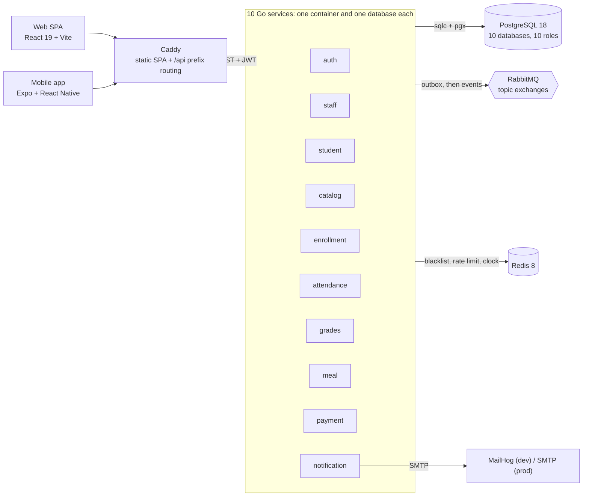

<div align="center">

# MyDreamCampus

**A university management platform built as 10 Go microservices, with a React web app and an Expo mobile app.**

Course enrollment, QR attendance, grading and cafeteria payments. One system, one `make deploy`.

[](https://github.com/Baaaki/MyDreamCampus/actions/workflows/ci.yml)
[](https://github.com/Baaaki/MyDreamCampus/actions/workflows/security.yml)
[](LICENSE)

English | [Türkçe](README_TR.md)

</div>

## Demo

<!-- The two images below are placeholders: add real screenshots under docs/screenshots/. -->

| Web | Mobile |
|-----|--------|
|  |  |

- **Live demo:** [mydreamcampus.madebybaki.com](https://mydreamcampus.madebybaki.com). It runs on a home server behind a Cloudflare Tunnel, so it can be offline.
- **No sign-up:** the login card has Student / Teacher / Admin buttons that fill in demo credentials.
- **Everything is editable, nothing is permanent:** a visitor's changes revert to the saved baseline one hour after the first change.
- **Time machine:** an admin page moves the clock of every service, so time-dependent behavior (enrollment windows, grading periods, QR expiry) can be explored.
- **Payments are fake:** the cafeteria accepts test cards only. No real money moves.

## What it does

- **Enrollment:** prerequisite, schedule-conflict and capacity checks, then advisor approval.
- **Attendance:** teacher-started sessions, signed QR codes that rotate every 15 seconds, manual marks and absence tracking.
- **Grades:** assessments, finalization and transcripts. A teacher sees only their own advisees' transcripts.
- **Cafeteria:** menus, meal reservations, test-card payment and one-time QR redemption.
- **Notifications:** an asynchronous service consumes events and sends e-mail.
- **Three roles** (admin, teacher, student) across a web app and a mobile app.

## Architecture



| Service | Owns | Service | Owns |
|---|---|---|---|
| `auth` | Identity, sessions, tokens | `attendance` | Attendance sessions, QR scans |
| `staff` | Teachers, profiles, admin-staff directory | `grades` | Grade entry, finalization, transcripts |
| `student` | Student records, advisors | `meal` | Cafeteria reservations |
| `catalog` | Course catalog, semesters, audit log | `payment` | Cafeteria payments (test cards only) |
| `enrollment` | Course selection, advisor approval | `notification` | E-mail notifications (push is a stub) |

**How the services talk**

- **Synchronous reads:** internal REST under `/internal/*`, signed with `X-Internal-Secret`. The edge never exposes these paths. Every target service has its own circuit breaker, so a dead service fails fast instead of hanging its callers.
- **Side effects:** events on RabbitMQ. Every publish goes through an **outbox** table written in the same transaction as the business row, so there is no state where the row exists and the event is lost. Consumers are idempotent (`event_id` is checked against `processed_events`).
- **Data isolation:** a service cannot connect to another service's database, because the role has no `CONNECT` grant. Another service's data is read over REST or projected locally from events.
- **One door:** the browser only sees Caddy. It serves the SPA and routes `/api/<prefix>` to the right service. Same origin, no CORS.

Who calls whom over internal REST (caller to callee):

```
catalog     -> staff      validate the instructor
student     -> staff      validate the advisor
enrollment  -> student    validate the student
enrollment  -> catalog    course list and course validation
attendance  -> catalog    semester info
grades      -> catalog    semester info
grades      -> student    advisor check (teachers see only their advisees)
meal        -> payment    start a payment / refund
```

Full tables (ports, databases, routes, events, internal contracts, env vars): [`microservices-migration/01-REFERANS-MIMARI.md`](microservices-migration/01-REFERANS-MIMARI.md) (in Turkish).

## Why this architecture?

- **Load is seasonal and uneven.** Enrollment week hammers `enrollment`, lunch break hits `meal`. One service can be restarted or redeployed without touching the other nine, and Caddy retries for up to 5 seconds so a single-service restart does not surface as a 502.
- **Hard data boundaries.** A database and a database role per service. There are no cross-database joins to grow into.
- **Side effects must survive downtime.** The outbox plus idempotent consumers, and a RabbitMQ topology loaded from `definitions.json` at broker boot, so messages queue up even when a consumer has never started.
- **Concurrency is handled where the data lives.** Seat counting in `enrollment` runs under advisory locks inside the transaction, and grade writes on one course are serialized by a per-course lock. Both are tested by racing requests against a real Postgres.
- **Shared code lives once.** The `shared/` Go module (middleware, errors, logger, RabbitMQ, Redis, clock) is compiled into every image.

### Trade-offs

| Chose | Over | What it costs | How it is contained |
|---|---|---|---|
| Microservices, a database each | A modular monolith (tried both; the earlier versions are frozen under the `v0-microservices` tag) | Network failure surface, 16 containers, eventual consistency | Circuit breakers, idempotency keys, outbox |
| Internal REST for reads, events for side effects | One style everywhere | Two integration styles | A mechanical rule: need the answer now, use REST; must survive downtime, use an event |
| Local projections fed by events (academic periods, passed prerequisites) | Reading other services at request time | A projection can lag | Idempotent consumers, topology that exists before consumers do |
| One Postgres instance, a database and role per service | Ten Postgres instances | Isolation is by credentials, not hardware; one shared failure domain | No `CONNECT` across databases, `make backup` |
| A shared HS256 secret | Per-service keys or asymmetric JWT | Any service holding the secret can mint tokens | Algorithm pinning, typed tokens, Redis blacklist |
| Caddy with path-prefix routing | A custom API gateway service | No gateway-level policy; each service verifies the JWT itself | No gateway code to maintain, same origin |
| Docker Compose on one host | Kubernetes | No horizontal scaling or rolling updates | `make deploy-<service>` rebuilds one service, Caddy retries during the restart |
| sqlc + pgx | An ORM | Hand-written SQL and a codegen step | Compile-time-checked, fully parameterized queries |

> For an in-depth dive into the architectural decisions, benchmark methodology and production trade-offs, read the [Engineering Deep Dive article](https://madebybaki.com/how-i-built-mydreamcampus).

## Tech stack

- **Backend:** Go 1.27, Gin, sqlc + pgx/v5, goose, PostgreSQL 18, RabbitMQ 4.3, Redis 8.10
- **Web:** React 19, Vite, Tailwind CSS v4, shadcn/ui, TanStack Query, react-router 8, ky
- **Mobile:** React Native 0.86, Expo 57 (Expo Router), TanStack Query, axios
- **Edge and delivery:** Caddy, Docker Compose, Cloudflare Tunnel, GitHub Actions, GHCR

## Security by design

Layered defense, based on OWASP recommendations.

**Authentication and sessions**
- Passwords are hashed with **Argon2id** (OWASP parameters) and compared in constant time. A dummy hash is verified for unknown users too, so login timing does not leak which accounts exist.
- **JWT (HS256, algorithm pinned)** with 15-minute access tokens and **refresh-token rotation**. A Redis JTI blacklist plus token versions revoke one session or all sessions (logout-all) immediately.
- Tokens travel in **httpOnly + SameSite=Strict** cookies (**Secure** in production). The refresh token is never written to a response body and is sent only to `/api/auth`. Nothing is kept in `localStorage`. Access and refresh tokens carry a `token_type`, so a refresh token cannot authorize an API call.
- **Brute force:** temporary lockout per account and client address. A locked attempt gets the same response as a wrong password, and an attacker cannot lock the owner out from another address. Redis **rate limiting** is per user when authenticated and per IP when anonymous, and fails closed on login.

**Application layer**
- **RBAC** (admin / teacher / student) enforced by route middleware.
- **CSRF** protection (double-submit cookie), a **CORS** allow-list (production refuses to start with it missing), and security headers: CSP, HSTS, X-Frame-Options, nosniff, Referrer-Policy, Permissions-Policy.
- All SQL goes through **sqlc + pgx**, fully parameterized. No string-built queries.
- 1 MB request-body limit and HTTP read/write timeouts against slowloris.
- Service-to-service calls carry `X-Internal-Secret` (constant-time compare). `/internal/*` is never proxied to the outside.
- Attendance and cafeteria QR codes are **HMAC-SHA256** signed and bound to a short time window. The attendance QR refreshes every 15 seconds, so a photo shared out of the classroom dies within seconds.
- Security events (failed login, lockout, authorization failure) go to an **audit log**.

**Configuration and supply chain**
- In production the app **refuses to start** with a weak or default secret (JWT, Redis, admin password, internal secret).
- Infrastructure ports (PostgreSQL, Redis, RabbitMQ) bind to `127.0.0.1`. Only 80/443 face the outside.
- CI runs **gitleaks**, **CodeQL**, **gosec** and **govulncheck** on every push and weekly. The CD pipeline scans every image with Trivy and does not push one that has a fixable CRITICAL CVE.

## Run it locally

**Requirements:** Docker, Go 1.27+, Bun (web), Node 20+ (mobile)

### Everything in containers (recommended)

One command starts 16 containers: infrastructure, 10 services, migrations, seed data, and Caddy serving the SPA.

```bash
cp new-backend/infrastructure/.env.example new-backend/infrastructure/.env
# fill in the CHANGE_ME values: openssl rand -hex 32
make deploy
```

`make deploy-ps` shows status, `make deploy-logs` follows the logs, and `make deploy-grades` rebuilds a single service without touching the others.

### One service with hot reload

Running ten services by hand is not a workflow. This path is for working on one service:

```bash
# 1. Infrastructure (Postgres, Redis, RabbitMQ, MailHog + migrations).
#    Run from the repo root: make loads the right compose files and binds the
#    infra ports to 127.0.0.1 (a bare `docker compose up` would not).
make infra

# 2. The service you are working on, on the host
make run-grades          # or run-auth, run-catalog, run-notification ...

# 3. Web app (new terminal)
cd frontend && bun install && bun dev
```

**Endpoints**
- Web app (containers): `http://localhost`. Vite dev server: `http://localhost:3000`
- Outgoing e-mail (MailHog): `http://localhost:8025`
- RabbitMQ management: `http://localhost:15672`
- API: services publish no ports. Everything goes through Caddy at `<origin>/api/<prefix>`

### Tests

```bash
make test               # backend (with -race) + frontend + mobile
make test-integration   # repositories and Redis guards on throwaway Postgres + Redis containers
make test-coverage      # backend coverage report

cd frontend && bun run typecheck && bun run lint && bun run test && bun run build
cd mobile && npx tsc --noEmit && npx jest --ci
```

- **Backend:** 795 Go test functions in 164 files, plus subtests. Integration tests race requests against real Postgres and Redis (the last seat in a course, concurrent approvals of one program).
- **Frontend:** 23 Vitest files. **Mobile:** 12 Jest files.
- **End to end:** the CI `backend-e2e` job boots the whole 16-container stack and runs a golden path through Caddy.

## Benchmarks

Only numbers that were actually measured are listed. Each one says where it came from.

| What | Result | Conditions |
|---|---|---|
| Argon2id hash (64 MiB, t=3, p=4) | ~36 ms per hash, ~32 ms per verify | Go benchmark, AMD Ryzen 7 5700X, `BenchmarkHashPassword` / `BenchmarkVerifyPassword` in `shared/platform/utils` |
| Full stack in memory (16 containers) | ~400 MB running, ~650 MB of images | Measured on a deployed stack, see [`DEPLOY.md`](DEPLOY.md) |
| Cold image build, all services at once | ~9 min, ~10 GB of builder memory | 4 CPU / 16 GB builder |
| Warm build (`auth` first, shared layers cached) | ~2.5 min, ~2.5 GB of builder memory | Same builder. `make deploy` and CI now do this warm-up on purpose |
| Seeding the demo dataset | ~30 s | Empty system, 19 faculties, 103 departments, 95 courses, 54 students |

**Not measured yet:** HTTP latency and throughput under load, Lighthouse scores, flamegraphs. There is no reproducible load-test harness in the repo, so none of those are claimed here.

> Benchmark methodology and the before/after analysis are covered in the [Engineering Deep Dive article](https://madebybaki.com/how-i-built-mydreamcampus).

## Deployment

- **Where:** one host with Docker Compose. The live demo runs on a home server with rootless Docker, published through a **Cloudflare Tunnel** (`EDGE=tunnel`). The same compose files run on a public VPS, where Caddy gets a Let's Encrypt certificate itself.
- **Edge:** Caddy serves the SPA and routes `/api/<prefix>`. The base compose file publishes only `:80`; the standalone overlay adds `:443` and the loopback infra ports.
- **Pipeline:** push to `main` runs CI (per-service vet, lint, build and test, integration tests, frontend and mobile checks, the full-stack e2e) and ends in a single `ci-passed` check. CD builds, scans and pushes the changed services' images to GHCR.
- **Auto-deploy:** the server polls `origin/main` every 2 minutes with a systemd timer and deploys only a commit whose `ci-passed` check succeeded. It is pull-based because a home server sits behind NAT.
- **Guide:** [`DEPLOY.md`](DEPLOY.md) (in Turkish) covers both setups step by step.

## Limitations

- **Payments are fake.** `payment` is not connected to a provider. A payment confirms only with test cards, and no money is charged.
- **Mobile push is a stub.** The push delivery path only logs. There is no FCM integration.
- **Some notification handlers are skeletons** (`grades.entered`, `student.graduated`).
- **Observability is thin.** There is no Prometheus, Grafana or Loki. A request id minted at Caddy ties the edge log and the service logs together, and that is the extent of tracing.
- **No load tests yet** (see Benchmarks), so capacity is unknown beyond the single-host footprint above.
- **Single host, single instances.** PostgreSQL, RabbitMQ and Redis are not replicated, and services do not scale horizontally.
- **One HS256 secret is shared by every service** (see Trade-offs).
- **First password equals the e-mail address** for a new account. The change is enforced by the server on first login.
- **The admin-staff directory** can be created only through the API and the seed. The UI has no create form.

None of these come from the split into microservices. They are separate work items.

> Lessons learned and what I would do differently are in the [Engineering Deep Dive article](https://madebybaki.com/how-i-built-mydreamcampus).

## Repository layout

```
new-backend/              Go workspace: shared/ + 10 services + infrastructure (compose, migrate, seed, demo-ops)
frontend/                 React 19 SPA served by Caddy
mobile/                   Expo app
microservices-migration/  Architecture reference tables (Turkish)
docs/                     Demo launch plan and seed data (Turkish)
DEPLOY.md                 Deployment guide (Turkish)
```

The earlier architectures (first nine microservices, then a modular monolith) are frozen under the `v0-microservices` git tag. Browse them read-only with `git checkout v0-microservices`, and return with `git checkout main`.

## License and contact

Licensed under the **GNU General Public License v3.0 (GPL-3.0)**. See [LICENSE](LICENSE).

Contact and support: [contact@madebybaki.com](mailto:contact@madebybaki.com)
