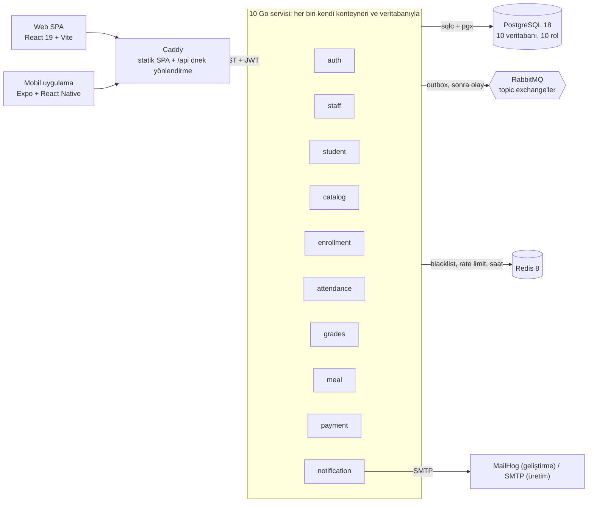

<div align="center">

# MyDreamCampus

**10 Go mikroservisinden oluşan, React web uygulaması ve Expo mobil uygulaması olan bir üniversite yönetim platformu.**

Ders kaydı, QR ile yoklama, not girişi ve kafeterya ödemeleri. Tek sistem, tek komut: `make deploy`.

[](https://github.com/Baaaki/MyDreamCampus/actions/workflows/ci.yml)
[](https://github.com/Baaaki/MyDreamCampus/actions/workflows/security.yml)
[](LICENSE)

[English](README.md) | Türkçe

</div>

## Demo

<!-- Aşağıdaki iki görsel yer tutucu: gerçek ekran görüntülerini docs/screenshots/ altına ekleyin. -->

| Web | Mobil |
|-----|--------|
|  |  |

- **Canlı demo:** [mydreamcampus.madebybaki.com](https://mydreamcampus.madebybaki.com). Cloudflare Tunnel arkasında bir ev sunucusunda çalışır, bu yüzden çevrimdışı olabilir.
- **Kayıt gerekmez:** giriş kartındaki Öğrenci / Öğretmen / Admin düğmeleri demo bilgilerini forma doldurur.
- **Her şey değiştirilebilir, hiçbir şey kalıcı değil:** bir ziyaretçinin değişiklikleri, ilk değişiklikten 1 saat sonra kaydedilmiş duruma geri döner.
- **Zaman makinesi:** admin sayfası tüm servislerin saatini kaydırır; zamana bağlı davranışlar (ders kayıt pencereleri, not dönemleri, QR süresi) incelenebilir.
- **Ödemeler sahte:** kafeterya yalnızca test kartı kabul eder. Gerçek para hareketi yoktur.

## Neler yapıyor

- **Ders kaydı:** önkoşul, ders saati çakışması ve kontenjan kontrolü; ardından danışman onayı.
- **Yoklama:** öğretmenin başlattığı oturumlar, 15 saniyede bir yenilenen imzalı QR kodları, elle işaretleme ve devamsızlık takibi.
- **Notlar:** değerlendirmeler, finalizasyon ve transkript. Öğretmen yalnızca kendi danışmanlık öğrencilerinin transkriptini görür.
- **Kafeterya:** menü, yemek rezervasyonu, test kartıyla ödeme ve tek kullanımlık QR ile teslim.
- **Bildirim:** ayrı bir servis olayları asenkron tüketip e-posta gönderir.
- **Üç rol** (admin, öğretmen, öğrenci); web ve mobil uygulamada.

## Mimari



| Servis | Sorumluluk | Servis | Sorumluluk |
|---|---|---|---|
| `auth` | Kimlik doğrulama, oturum, token | `attendance` | Yoklama oturumları, QR okutma |
| `staff` | Öğretim üyeleri, profiller, idari personel rehberi | `grades` | Not girişi, finalizasyon, transkript |
| `student` | Öğrenci kayıtları, danışman | `meal` | Yemekhane rezervasyonu |
| `catalog` | Ders kataloğu, dönemler, denetim kaydı | `payment` | Yemekhane ödemesi (yalnız test kartı) |
| `enrollment` | Ders seçimi, danışman onayı | `notification` | E-posta bildirimi (push iskelet) |

**Servisler birbirini nasıl görür**

- **Senkron okuma:** `/internal/*` altında internal REST, `X-Internal-Secret` başlığıyla imzalı. Ağ geçidi bu yolları dışarı açmaz. Her hedef servisin kendi **devre kesicisi** (circuit breaker) vardır: servis düştüğünde çağıran taraf beklemek yerine anında hata alır.
- **Yan etki:** RabbitMQ üzerinden olay. Her yayın, iş kaydıyla aynı transaction'da yazılan bir **outbox** tablosundan geçer; kaydın yazılıp olayın kaybolduğu bir ara durum oluşmaz. Tüketiciler idempotenttir (`event_id`, `processed_events` ile kontrol edilir).
- **Veri izolasyonu:** bir servis başka servisin veritabanına bağlanamaz, çünkü rolde `CONNECT` yetkisi yoktur. Başka servisin verisi ya REST ile okunur ya da olaylarla kendi tarafına projekte edilir.
- **Tek giriş kapısı:** tarayıcı yalnızca Caddy'yi görür. Caddy SPA'yı sunar ve `/api/<önek>` yolunu ilgili servise yönlendirir. Aynı origin, CORS yok.

Internal REST üzerinden kim kimi çağırıyor (çağıran, çağrılan):

```
catalog     -> staff      öğretim üyesi doğrulama
student     -> staff      danışman doğrulama
enrollment  -> student    öğrenci doğrulama
enrollment  -> catalog    ders listesi ve ders doğrulama
attendance  -> catalog    dönem bilgisi
grades      -> catalog    dönem bilgisi
grades      -> student    danışman doğrulama (öğretmen yalnız danışmanı olduğu öğrenciyi görür)
meal        -> payment    ödeme başlatma / iade
```

Tüm tablolar (port, veritabanı, route, olay, internal kontrat, env değişkenleri): [`microservices-migration/01-REFERANS-MIMARI.md`](microservices-migration/01-REFERANS-MIMARI.md).

## Neden bu mimari?

- **Yük dönemsel ve dengesiz.** Ders kayıt haftası `enrollment`'ı, öğle arası `meal`'i zorlar. Tek servis, diğer dokuzuna dokunmadan yeniden başlatılabilir; Caddy 5 saniyeye kadar yeniden dener, böylece tek servis restart'ı 502 olarak görünmez.
- **Sert veri sınırları.** Servis başına ayrı veritabanı ve ayrı veritabanı rolü. Sonradan büyüyecek bir cross-database join yoktur.
- **Yan etkiler kesintiden sağ çıkmalı.** Outbox ve idempotent tüketiciler; ayrıca RabbitMQ topolojisi broker açılışında `definitions.json` ile yüklenir, bir tüketici hiç başlamamış olsa bile mesajlar kuyrukta birikir.
- **Yarışlar verinin olduğu yerde çözülür.** `enrollment`'ta kontenjan sayımı transaction içinde advisory lock ile yapılır; bir derse yazılan notlar ders başına kilitle sıraya girer. İkisi de gerçek Postgres'e yarışan isteklerle test edilir.
- **Ortak kod bir kez yazılır.** `shared/` Go modülü (middleware, hata, logger, RabbitMQ, Redis, saat) her imajın içine derlenir.

### Ödünleşimler (trade-offs)

| Seçilen | Yerine | Bedeli | Nasıl sınırlandı |
|---|---|---|---|
| Mikroservis, servis başına veritabanı | Modüler monolit (ikisi de denendi; önceki sürümler `v0-microservices` tag'inde donduruldu) | Ağ hata yüzeyi, 16 konteyner, nihai tutarlılık | Devre kesici, idempotency anahtarı, outbox |
| Okuma için internal REST, yan etki için olay | Her yerde tek yöntem | İki entegrasyon biçimi | Mekanik kural: cevabı şimdi lazımsa REST; kesintiden sağ çıkmalıysa olay |
| Olayla beslenen yerel projeksiyonlar (akademik dönem, geçilen önkoşul) | İstek anında başka servisi okumak | Projeksiyon geriden gelebilir | Idempotent tüketici, tüketiciden önce var olan topoloji |
| Tek Postgres örneği, servis başına veritabanı ve rol | On ayrı Postgres | İzolasyon donanımla değil yetkiyle; ortak hata alanı | Veritabanları arası `CONNECT` yok, `make backup` |
| Ortak HS256 secret | Servis başına anahtar veya asimetrik JWT | Secret'a sahip her servis token üretebilir | Algoritma pinleme, tipli token, Redis blacklist |
| Caddy ile path-prefix yönlendirme | Özel bir API gateway servisi | Gateway seviyesinde politika yok; her servis JWT'yi kendi doğrular | Bakılacak gateway kodu yok, aynı origin |
| Tek makinede Docker Compose | Kubernetes | Yatay ölçekleme ve rolling update yok | `make deploy-<servis>` tek servisi yeniden derler, Caddy restart sırasında yeniden dener |
| sqlc + pgx | ORM | Elle yazılan SQL ve bir kod üretim adımı | Derleme zamanında kontrol edilen, tamamen parametreli sorgular |

> Mimari kararların, ölçüm yönteminin ve production ödünleşimlerinin derinlemesine anlatımı için: [Mühendislik makalesi](https://madebybaki.com/mydreamcampus-nasil-yapildi).

## Teknoloji yığını

- **Arka uç:** Go 1.27, Gin, sqlc + pgx/v5, goose, PostgreSQL 18, RabbitMQ 4.3, Redis 8.10
- **Web:** React 19, Vite, Tailwind CSS v4, shadcn/ui, TanStack Query, react-router 8, ky
- **Mobil:** React Native 0.86, Expo 57 (Expo Router), TanStack Query, axios
- **Edge ve dağıtım:** Caddy, Docker Compose, Cloudflare Tunnel, GitHub Actions, GHCR

## Güvenlik (Security by Design)

OWASP tavsiyeleri temel alınarak katmanlı savunma prensibiyle tasarlanmıştır.

**Kimlik doğrulama ve oturum yönetimi**
- Parolalar **Argon2id** ile hash'lenir (OWASP önerilen parametreler) ve constant-time karşılaştırılır. Var olmayan kullanıcı için de dummy hash doğrulanır; login yanıt süresi üzerinden hangi hesapların var olduğu (**user enumeration**) sızmaz.
- **JWT (HS256, algoritma pinlemeli)**, 15 dakikalık access token ve **refresh token rotation**. Redis üzerinde JTI blacklist ve token-version takibiyle tek oturum ya da tüm oturumlar (logout-all) anında iptal edilir.
- Token'lar **httpOnly + SameSite=Strict** (production'da **Secure**) cookie'lerde taşınır. Refresh token yanıt gövdesine yazılmaz ve yalnızca `/api/auth` altına gönderilir. `localStorage`'da token tutulmaz. Access ve refresh token'lar `token_type` ile ayrılır; refresh token bir API isteğini yetkilendiremez.
- **Brute-force:** hesap + istemci adresi bazlı geçici kilitleme. Kilitli deneme yanlış şifreyle aynı yanıtı alır, saldırgan da hesap sahibini başka bir adresten dışarıda bırakamaz. Redis tabanlı **rate limiting** kimliği doğrulanmış istekte kullanıcı, anonim istekte IP bazlıdır ve login'de fail-closed çalışır.

**Uygulama katmanı**
- **RBAC** (admin / teacher / student) route seviyesinde middleware ile zorunlu kılınır.
- **CSRF** koruması (double-submit cookie), **CORS** allow-list (production'da eksikse uygulama açılmayı reddeder) ve güvenlik başlıkları: CSP, HSTS, X-Frame-Options, nosniff, Referrer-Policy, Permissions-Policy.
- Tüm SQL **sqlc + pgx** ile, tamamen parametreli. String birleştirmeli sorgu yoktur.
- 1 MB istek gövdesi limiti ve slowloris'e karşı HTTP read/write timeout'ları.
- Servisler arası çağrılar `X-Internal-Secret` ile doğrulanır (constant-time compare). `/internal/*` dışarıya proxy'lenmez.
- Yoklama ve yemekhane QR'ları **HMAC-SHA256** imzalıdır ve kısa bir zaman penceresine bağlıdır. Yoklama QR'ı 15 saniyede bir yenilenir; sınıftan paylaşılan bir fotoğraf birkaç saniyede geçersizleşir.
- Güvenlik olayları (başarısız login, hesap kilitleme, yetki ihlali) **audit log**'a yazılır.

**Yapılandırma ve tedarik zinciri**
- Production'da zayıf ya da varsayılan secret (JWT, Redis, admin parolası, internal secret) tespit edilirse uygulama **başlamayı reddeder**.
- Altyapı portları (PostgreSQL, Redis, RabbitMQ) yalnızca `127.0.0.1`'e bağlıdır; dışarıya sadece 80/443 açılır.
- CI her push'ta ve haftalık olarak **gitleaks**, **CodeQL**, **gosec** ve **govulncheck** çalıştırır. CD hattı her imajı Trivy ile tarar ve düzeltilebilir CRITICAL CVE'si olan imajı push etmez.

## Yerel ortamda çalıştırma

**Gereksinimler:** Docker, Go 1.27+, Bun (web), Node 20+ (mobil)

### Hepsi container'da (önerilen)

Tek komut 16 konteyneri ayağa kaldırır: altyapı, 10 servis, migration, seed veri ve SPA'yı sunan Caddy.

```bash
cp new-backend/infrastructure/.env.example new-backend/infrastructure/.env
# .env içindeki CHANGE_ME değerlerini doldurun: openssl rand -hex 32
make deploy
```

`make deploy-ps` durumu, `make deploy-logs` logları gösterir. Tek bir servisi diğerlerine dokunmadan yeniden derlemek için `make deploy-grades`.

### Tek servis, hot reload

On servisi elle çalıştırmak bir iş akışı değildir; bu yol tek bir servis üzerinde çalışırken kullanılır:

```bash
# 1. Altyapı (Postgres, Redis, RabbitMQ, MailHog + migration).
#    Repo kökünden çalıştırın: make doğru compose dosyalarını yükler ve
#    infra portlarını 127.0.0.1'e açar (çıplak `docker compose up` açmaz).
make infra

# 2. Üzerinde çalıştığınız servisi host'ta başlatın
make run-grades          # veya run-auth, run-catalog, run-notification ...

# 3. Web arayüzü (yeni terminal)
cd frontend && bun install && bun dev
```

**Erişim noktaları**
- Web arayüzü (container'da): `http://localhost`. Vite dev sunucusu: `http://localhost:3000`
- Giden e-postalar (MailHog): `http://localhost:8025`
- RabbitMQ yönetim paneli: `http://localhost:15672`
- API: servislerin yayınlanan portu yoktur. Hepsi Caddy üzerinden `<origin>/api/<önek>`

### Testler

```bash
make test               # backend (-race ile) + frontend + mobil
make test-integration   # repository ve Redis korumaları, geçici Postgres + Redis konteynerlerinde
make test-coverage      # backend kapsam raporu

cd frontend && bun run typecheck && bun run lint && bun run test && bun run build
cd mobile && npx tsc --noEmit && npx jest --ci
```

- **Backend:** 164 dosyada 795 Go test fonksiyonu, ayrıca alt testler. Entegrasyon testleri gerçek Postgres ve Redis'e yarışan istekler gönderir (bir dersin son kontenjanı, aynı programın eşzamanlı onayları).
- **Frontend:** 23 Vitest dosyası. **Mobil:** 12 Jest dosyası.
- **Uçtan uca:** CI'daki `backend-e2e` job'u 16 konteynerin tamamını ayağa kaldırıp golden path'i Caddy üzerinden koşar.

## Benchmark

Yalnızca gerçekten ölçülmüş sayılar yazıldı. Her birinin nereden geldiği belirtildi.

| Ne | Sonuç | Koşullar |
|---|---|---|
| Argon2id hash (64 MiB, t=3, p=4) | hash başına ~36 ms, doğrulama başına ~32 ms | Go benchmark, AMD Ryzen 7 5700X, `shared/platform/utils` içindeki `BenchmarkHashPassword` / `BenchmarkVerifyPassword` |
| Tüm yığının belleği (16 konteyner) | çalışırken ~400 MB, imajlar ~650 MB | Dağıtılmış yığında ölçüldü, bkz. [`DEPLOY.md`](DEPLOY.md) |
| Soğuk imaj derlemesi, tüm servisler aynı anda | ~9 dk, builder'da ~10 GB bellek | 4 CPU / 16 GB builder |
| Sıcak derleme (önce `auth`, paylaşılan katmanlar önbellekte) | ~2,5 dk, builder'da ~2,5 GB bellek | Aynı builder. `make deploy` ve CI bu ısındırmayı bilerek yapar |
| Demo veri setinin seed edilmesi | ~30 sn | Boş sistem, 19 fakülte, 103 bölüm, 91 ders, 54 öğrenci |

**Henüz ölçülmedi:** yük altında HTTP gecikmesi ve verim, Lighthouse skorları, flamegraph'lar. Repoda tekrarlanabilir bir yük testi altyapısı yok; bu yüzden burada bunlarla ilgili hiçbir iddia yer almıyor.

> Benchmark yöntemi ve öncesi/sonrası analizi [Mühendislik makalesinde](https://madebybaki.com/mydreamcampus-nasil-yapildi) anlatılıyor.

## Dağıtım

- **Nerede:** Docker Compose ile tek makine. Canlı demo, rootless Docker'lı bir ev sunucusunda çalışır ve **Cloudflare Tunnel** (`EDGE=tunnel`) ile yayınlanır. Aynı compose dosyaları public bir VPS'te de çalışır; orada Caddy Let's Encrypt sertifikasını kendisi alır.
- **Edge:** Caddy SPA'yı sunar ve `/api/<önek>` yolunu yönlendirir. Temel compose dosyası yalnızca `:80`'i yayınlar; standalone katmanı `:443`'ü ve loopback infra portlarını ekler.
- **Hat:** `main`'e push CI'ı çalıştırır (servis başına vet, lint, build ve test, entegrasyon testleri, frontend ve mobil kontroller, tam yığın e2e) ve tek bir `ci-passed` kontrolüyle biter. CD, değişen servislerin imajlarını derler, tarar ve GHCR'a push eder.
- **Otomatik deploy:** sunucu bir systemd timer ile `origin/main`'i 2 dakikada bir yoklar ve yalnızca `ci-passed` kontrolü başarılı olan bir commit'i deploy eder. Ev sunucusu NAT arkasında olduğu için çekme (pull) tabanlıdır.
- **Rehber:** [`DEPLOY.md`](DEPLOY.md) iki kurulumu adım adım anlatır.

## Sınırlamalar

- **Ödemeler sahte.** `payment` bir sağlayıcıya bağlı değil. Ödeme yalnızca test kartlarıyla onaylanır, para çekilmez.
- **Mobil push iskelet.** Push gönderim yolu yalnızca loglar. FCM entegrasyonu yok.
- **Bazı bildirim handler'ları iskelet** (`grades.entered`, `student.graduated`).
- **Gözlemlenebilirlik zayıf.** Prometheus, Grafana, Loki yok. Caddy'de üretilen istek kimliği edge logu ile servis loglarını bağlar; izleme bundan ibarettir.
- **Henüz yük testi yok** (bkz. Benchmark); bu yüzden yukarıdaki tek makine ayak izi dışında kapasite bilinmiyor.
- **Tek makine, tek örnek.** PostgreSQL, RabbitMQ ve Redis replike değil, servisler yatay ölçeklenmiyor.
- **Tüm servisler tek bir HS256 secret'ı paylaşıyor** (bkz. Ödünleşimler).
- **Yeni hesabın ilk şifresi e-posta adresidir.** Değişim ilk girişte sunucu tarafından zorunlu kılınır.
- **İdari personel rehberi** yalnızca API ve seed ile oluşturulabilir. Arayüzde oluşturma formu yok.

Bunların hiçbiri mikroservis bölünmesinden kaynaklanmıyor. Ayrı iş kalemleri.

> Çıkarılan dersler ve bugün sıfırdan başlasam neyi farklı yapacağım [Mühendislik makalesinde](https://madebybaki.com/mydreamcampus-nasil-yapildi).

## Repo yapısı

```
new-backend/              Go workspace: shared/ + 10 servis + infrastructure (compose, migrate, seed, demo-ops)
frontend/                 Caddy'nin sunduğu React 19 SPA
mobile/                   Expo uygulaması
microservices-migration/  Mimari referans tabloları
docs/                     Demo yayın planı ve seed veri
DEPLOY.md                 Dağıtım rehberi
```

Önceki mimariler (önce 9 ayrı mikroservis, ardından modüler monolit) `v0-microservices` git tag'i altında dondurulmuştur. Salt-okunur gezmek için `git checkout v0-microservices`, geri dönmek için `git checkout main`.

## Lisans ve iletişim

Bu proje **GNU General Public License v3.0 (GPL-3.0)** altında lisanslanmıştır. Detaylar için [LICENSE](LICENSE) dosyasına bakabilirsiniz.

İletişim ve destek: [contact@madebybaki.com](mailto:contact@madebybaki.com)
